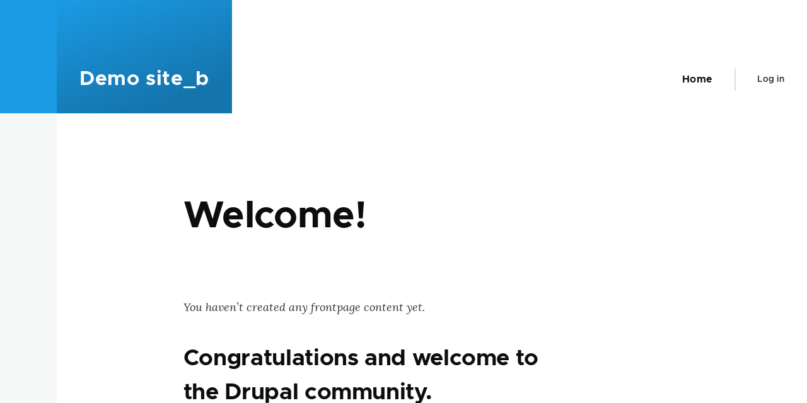

# Execution evidence

What has actually been run, where, and what it showed. Anything not listed as run here has **not** been run. Each item says whether it ran on a local machine, on a GitHub Actions runner, or on AWS. Nothing has run on AWS yet.

## Environments

| Name | Where | Versions |
|---|---|---|
| Local | macOS (Apple silicon), Docker Desktop | Docker 29.2.1, PHP 8.3.37, Drupal 11.4.13, Drush 13.8.1, MariaDB 11.4.13 |
| CI | GitHub Actions `ubuntu-latest` | Same image, built from this folder on every run; kind for Kubernetes |
| AWS | — | **Not run** |

## Results

| Test | Where | Date | How | Result |
|---|---|---|---|---|
| Docker image build | Local, CI | 2026-11-20 | `docker build` | Pass: Drupal core in `web/core`, Drush finds both sites |
| Both sites install | Local, CI | 2026-11-20 | [`tests/compose/smoke.sh`](../tests/compose/smoke.sh) | Pass |
| Hostname routing | Local, CI | 2026-11-20 | Compose smoke test | Pass: `site-a.localhost` → 200 "Demo site_a", `site-b.localhost` → 200 "Demo site_b" |
| Separate databases | Local, CI | 2026-11-20 | Compose smoke test, plus direct SQL locally | Pass: each site reports its own database; 43 tables in each; a config change on site A is not visible on site B |
| Unknown hostname refused | Local, CI | 2026-11-20 | Compose smoke test | Pass: `/` and `/core/install.php` both 404 |
| Config sync outside public files | Local, CI | 2026-11-20 | Compose smoke test | Pass: `../config/<site>/sync` |
| Cron per site | Local, CI | 2026-11-20 | Compose smoke test | Pass: `system.cron_last` set on both sites |
| Site-to-database validator | Local, CI | 2026-11-20 | [`tests/site-databases/run.sh`](../tests/site-databases/run.sh) | Pass: valid file accepted; 9 kinds of bad input rejected |
| Helm lint and schema validation | Local, CI | 2026-11-20 | `helm lint`, `kubeconform -strict` | Pass: 6 resources valid (Deployment, Service, HPA, 2 CronJobs, Ingress) |
| Helm install on Kubernetes | CI (kind) | 2026-11-20 | [`tests/k8s/smoke.sh`](../tests/k8s/smoke.sh) | Pass: chart installs; pod ready with 0 restarts |
| Both sites on Kubernetes | CI (kind) | 2026-11-20 | kind smoke test | Pass: each site installs into its own database; `site-a.example.org` and `site-b.example.org` → 200 with their own titles through the Service; unknown host → 404 |
| Files volume writable | CI (kind) | 2026-11-20 | kind smoke test | Pass: Drupal generated each site's aggregated CSS on the volume (200) |
| Per-site CronJobs | CI (kind) | 2026-11-20 | kind smoke test | Pass: a Job created from each CronJob completed and set `system.cron_last` |
| EKS deployment | AWS | — | — | **Not run** |
| Load test | — | — | — | **Not run** |
| Backup and restore from Acquia | — | — | — | **Not run** |
| Reverse-proxy tests (runbook Phase 8) | — | — | — | **Not run** (needs a real ALB) |
| Rollback rehearsal | — | — | — | **Not run** |

## CI runs

Every push that changes this folder runs [the workflow](../../.github/workflows/demo-validate.yml); see the [list of runs](https://github.com/anisur-rahman/drupal-blt-to-eks-runbook/actions/workflows/demo-validate.yml). Each run keeps the smoke test logs as downloadable artifacts (`compose-smoke-log`, `k8s-smoke-log`).

First fully passing run of all three jobs: [run 44817880453](https://github.com/anisur-rahman/drupal-blt-to-eks-runbook/actions/runs/44817880453).

## Known warnings

- **Private files directory (cron Jobs on kind):** Drupal logs that it couldn't write `.htaccess` to the private files directory. The demo points private files at a placeholder path in `/tmp` inside the container; production needs a mounted private volume (runbook Phases 14–15). Cron still completes.
- **HPA metrics (kind):** the HPA reports `cpu: <unknown>` because kind has no metrics-server. EKS installs it as an add-on (runbook Phase 12).

## Screenshots

Taken from the local Compose stack after the smoke test. Site A shows the slogan that was set only on site A; site B doesn't have it, which shows the databases are separate.

| Site A | Site B |
|---|---|
|  |  |

The full output of the local run is in [`evidence/compose-smoke.log`](evidence/compose-smoke.log).

## Defects found by running the demo

The first version of this demo passed static checks (PHP syntax, Compose config, Helm lint). These problems only showed up when the code was committed, built and actually run:

| # | Symptom | Cause | Fix |
|---|---|---|---|
| 1 | `docker build` failed | Drush 13 pulls in Composer plugins that `composer.json` didn't allow | Listed them in `allow-plugins` |
| 2 | Drush couldn't bootstrap Drupal | No `installer-paths`, so core was installed in `vendor/drupal/core` | Added `composer/installers` and the standard paths |
| 3 | Every page was a PHP fatal error, but returned **HTTP 200** | Drupal 11.4's `index.php` needs `symfony/runtime`, which had been disabled while fixing #1; PHP printed errors into the page | Allowed `symfony/runtime`; switched to the production `php.ini`, so errors are logged instead of shown |
| 4 | Both sites returned HTTP 400 "host name is not valid" | A doubled backslash in the trusted-host pattern in `compose.yaml` | One backslash |
| 5 | Unknown hostnames were offered the Drupal installer | No `sites/default`, so Drupal fell back to the installer | `sites/default/settings.php` returns 404 |
| 6 | Sites wouldn't load under the Helm chart's hostnames | `sites.php` only mapped `*.localhost` | Mapped both the local and the chart hostnames |
| 7 | Drupal created its config directory inside **public files** | `config_sync_directory` wasn't set | Set it to `../config/<site>/sync` |
| 8 | Cron sometimes skipped a site ("already running") | `automated_cron` ran cron on page requests alongside scheduled cron | Uninstalled `automated_cron`; cron runs from a schedule (CronJob on Kubernetes) |
| 9 | `web/sites/*.php` files were missing from the repository | `.gitignore` ignored `web/`, so the `!` re-include rules had no effect | Fixed the ignore patterns |
| 10 | A PHP warning on every request (`zend.assertions`) | Drupal's `.htaccess` sets it to `0`, but the production `php.ini` value `-1` can't be changed at runtime | Set `zend.assertions = 0` in the image |

Number 3 is why the smoke tests check page content and titles, not just status codes.
